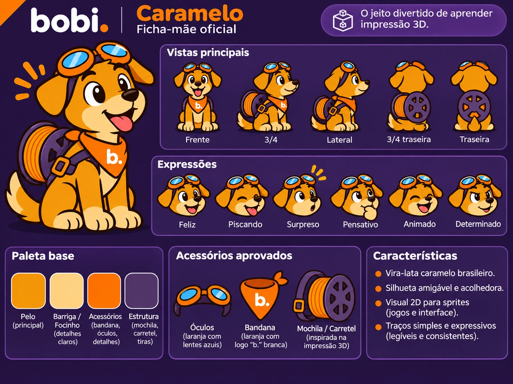

# Caramelo — ficha-mãe visual de referência (v0.1)

**Data de seleção:** 02/11/2026  
**Projeto:** bobi. — O jeito divertido de aprender impressão 3D.  
**Status:** direção visual-base selecionada pelo responsável; ficha-mãe de produção e sprites individuais ainda pendentes.

## Arquivo

- [`ficha-mae-v01.webp`](ficha-mae-v01.webp): representação visual de referência do Caramelo (cachorro caramelo brasileiro), com vistas principais, expressões, acessórios ilustrativos e paleta indicativa.
- Formato: **WebP, 1448 × 1086, RGB**, compressão de alta qualidade a partir da prancha de referência original.
- **Não é** PNG com transparência, arte vetorial, atlas fatiável ou sequência de quadros animados.

## Como usar esta referência

1. Preservar o conceito de **cachorro caramelo brasileiro** com estilo cartoon 2D amigável e expressivo.
2. Usar as vistas, expressões e acessórios como ponto de partida para desenhar a ficha-mãe consistente, não como modelos técnicos dimensionados.
3. Não alterar silenciosamente anatomia, estilo, espessura do traço, cor ou escala entre sprites.
4. Produzir sprites separados em PNG RGBA quando o jogo exigir transparência; documentar nome, estado, tamanho, versão, âncora e revisão.
5. Considerar **provisórios** os tons e acessórios da própria imagem, mesmo onde a prancha use a expressão "Acessórios aprovados". A escolha da pegada visual **não** equivale à aprovação individual desses detalhes.

A [direção de arte](../../direcao-de-arte.md) e o [sistema visual e de animação](../../sistema-visual-narrativa-e-animacao.md) continuam sendo os documentos de trabalho. Não usar esta imagem diretamente como sprite de interface, porque contém fundo, legendas e múltiplas poses numa única prancha.
